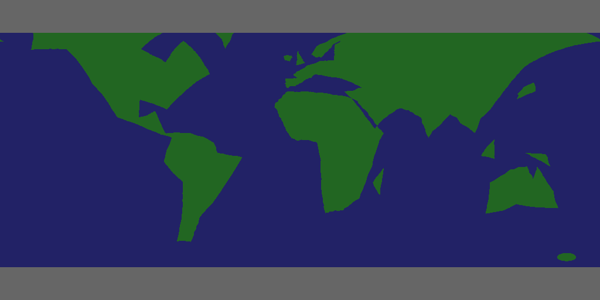

# Planet surfaces: how they are stored and drawn

How a planet's surface (seas, continents, ice caps, craters) is described in the game's data, how the original
game draws it, how our native renderer turns it into a texture, and why Earth looks the way it does.

Tags: **[code]** read from `fe2/fe2.s` or our source, **[measured]** decoded from the game binary with a
scratch tool (section 8), **[inferred]** a conclusion that could be wrong.

Related: `docs/level-of-detail.md` section 7 (planet splitting and detail), `docs/system-generation.md`
(which model a planet gets).

## 1. Short version

- There is **no bitmap texture** anywhere in the game. A planet's surface is a short list of vector shapes
  inside its model: polygons ("outlines") and circles on the unit sphere, each with a 2-bit-ish **code**.
  Colours come from a table of at most 16 entries chosen by XOR-ing the codes of the shapes a point is inside.
- **Earth (model 72) is 372 bytes in total.** Its continents are **92 points** spread over 11 polygons, plus
  two polar-cap circles and one small circle. The Americas are one 26-point polygon, Africa is 8 points,
  Australia 9, Greenland, Japan, Borneo, New Guinea and Madagascar are triangles or quadrilaterals.
- Each point is three **signed bytes** (a direction of length about 64), so a corner can only sit on a grid
  of about 0.9 degrees, roughly **100 km** on Earth.
- Edges between points are long (Earth: 15 to 43 degrees, i.e. 1,600 to 4,800 km). The game breaks them up
  with **pseudo-random midpoint displacement** (a fractal), which adds wiggle but no geography: the bays,
  peninsulas and inland seas you'd expect are not in the data, so they can't appear.
- Our renderer (`src/gl/gl_planet_tex.c`) runs the same fractal to a fixed 6 levels and fills the result into
  a **2048 x 1024 code texture** (one byte per texel, equirectangular). On Earth a texel is about **20 km**
  square at the equator; the shader blends the four nearest texels' colours, so coasts are soft 20 km
  ramps over straight 25 to 75 km segments.
- Only 4 colours on Earth: sea `226`, land `262`, ice `666` (twice). No deserts, mountains or rivers.

So "oceans and coastlines are there but poorly defined" is the source data, not the renderer losing it.
Section 7 lists what could be done.



*Earth's decoded surface, east to the right. Grey bands top and bottom are the polar-cap circles.*


*The same with no fractal displacement: these straight-edged polygons are all the geography there is.*

## 2. Where the data lives

[code] A planet is an ordinary model (models 61-86, 193, 194; Earth is 72) whose bytecode contains the
**planet command, op `$1f`**, run by `L3cd9c_ProjectPlanet`:

| bytes | meaning |
|---|---|
| word 0 | op `$1f` in the low 5 bits; `(w0 >> 4) & $ffe` = length of the data that follows, in bytes |
| word 1 | radius word (the planet's radius; normalised so its top bit is bit 14, then used as a scale) |
| word 2 | vertex index of the planet's centre |
| then | the surface data, `length` bytes (below) |

[measured] Sizes of the surface data: Earth 372 bytes, model 63 466, most others 12 to 172. Earth is the
most detailed planet in the game by a wide margin (next: model 63 with 33 outline points, then model 69 with 26).

## 3. The surface data format

[code] (`gl_planet_tex.h` has the same description; parser `parse()` in `gl_planet_tex.c`)

### 3.1 Colours

- `+0` colour word: high nibble = flags, low 12 bits = colour 0 (rgb444).
  - flag bit 7 (`$80` in the first byte): the game builds a second, sunlit table (`L3d0be`), giving
    separate dark-side (0-7) and lit-side (8-15) colours. Earth has it.
  - flag bit 6: no extra colours follow.
  - flag bit 4: a selector word and 7 alternative sets of 4 colours follow (models 63, 73, 75 use this:
    one model, several colour schemes).
- `+2, +4, +6` colours 1-3.
- unless bit 4 or bit 6: 4 more colours (`+8..+14`).

Earth: `8226 0262 0666 0666`, then `0226 0226 0226 0226`. So code 0 = sea (dark blue `226`), code 4 = land
(green `262`), codes 8 and 12 = ice (grey `666`), the rest sea.

The values are the Atari's 3-bit-per-channel palette (only even nibbles), so `226` is about
RGB(34, 34, 102) once scaled up.

### 3.2 The band list

A word list follows the colours, `0` ends it. For Earth: `0008`, then `401d 0888`, `402c 0668`, `4044 0448`,
`4068 0228`, `0000`. [inferred] These are atmosphere bands (a height or angle, then a colour fading from pale
grey to blue): the haze ring round the limb that `L3da2e` draws and `gl_atmos.c` re-draws natively. The
texture builder skips this list.

### 3.3 Features

Then features, each starting with a code byte; `0` ends the list.

**Outline** (code bit 7 clear): a spherical polygon.

```
code            the feature's code (Earth: always 04 = land)
detail          signed byte: how strong the fractal displacement is (Earth: -4 to -6; more negative = rougher)
x y z           first point: signed bytes, a direction from the centre, length ~64
x y z ...       next points; the x of each point is read first, x = 0 ends the outline
```

A first point immediately followed by `0` is not part of the outline but a **marker** with a size byte.
[code] When the planet is big on screen (`120(a3) >= $1000`) and the spot the view is centred on is within
`size * 130(a3)` of the marker, `L3d452` sets `188(a3)`, which (`l3ddb6`) keeps that outline being refined.
[inferred] It is a "near here, draw this in full" hint. Earth has two: one on Britain (size 5) and one on the
Eurasia polygon (size 11).

**Circle** (code bit 7 set): ice caps, craters, round islands.

```
code            & $1c = the feature's code; bit 6 = also draw the opposite circle (both poles)
x y z           centre, negated signed bytes
r               angular radius: r * 64 in 16-bit angle units (r * 0.35 degrees)
```

### 3.4 Earth, feature by feature

[measured] Longitudes here are real-world (east positive), after undoing the mirror described in 6.4.

| feature | points | edge length (mean / max) | notes |
|---|---|---|---|
| polar caps | circle | | radius 19.7 deg at both poles (down to about 70 deg N/S) |
| Britain | 5 | 4 / 8 deg | has a marker (size 5) |
| Ireland | 4 | 3 / 3 deg | |
| small round island | circle | | 2.5 deg radius, about 64 S 160 E; [inferred] not a real place, maybe a placeholder or a lost feature |
| Eurasia | 24 | 15 / 29 deg | one polygon, 7 N to 75 N; marker size 11 |
| Africa | 8 | 26 / 43 deg | detail -6, the roughest |
| Madagascar | 3 | 12 / 16 deg | a triangle |
| Australia | 9 | 14 / 21 deg | |
| Greenland | 3 | 17 / 22 deg | a triangle |
| Borneo | 3 | 11 / 13 deg | a triangle |
| New Guinea | 3 | 12 / 17 deg | a triangle |
| Japan | 4 | 7 / 11 deg | |
| the Americas | 26 | 17 / 43 deg | North and South America as one polygon, 55 S to 71 N |

Not present at all: Antarctica (only the ice circle), India as a separate shape, Arabia, the Mediterranean as
more than a gap, the Black/Caspian seas, Indonesia beyond Borneo/New Guinea, Iceland, New Zealand, the Great
Lakes, Hudson Bay, Central American detail, Caribbean islands.

### 3.5 Other planets for comparison

[measured]

| model | data bytes | outline points | circles | look |
|---|---|---|---|---|
| 72 Earth | 372 | 92 | 3 | as above |
| 63 | 466 | 33 | several | 7 colour sets; the long length is mostly the colour sets |
| 69 (Earth-like, green seas) | 128 | 26 | 0 | 4 continents |
| 61, 65 | 102, 160 | 20, 16 | several | 4-point patches, crater-like circles |
| 68 | 94 | 12 | 3 | |
| 70 | 112 | 21 | 0 | |
| 73-76 (gas giants) | 90-172 | 0-22 | big pole-centred circles | bands made of nested circles round the pole |
| 64, 66, 71, 77-86 | 12-38 | 0 | 0 | one colour |
| 193, 194 | 110 | 18 | 0 | six triangles |

So every planet of a given model has the same continents; only the colours (flag bit 4 sets), the seed (below)
and the axis tilt differ.

## 4. The coloring rule

[code] The colour of a point is `table[code / 4]`, where `code` is the **XOR** of the codes of every feature
that contains the point. Outlines are filled even-odd, so a polygon inside a polygon cuts a hole. On Earth,
land (`04`) under an ice cap (`0c`) gives `08`, which is also grey; sea under ice gives `0c`, grey.

The game's software renderer does this as a scanline fill of its 2D planet shape (`gl_planet.h` describes that
list: edges carry codes, a row command changes the code, a 16-entry colour table ends the shape).

## 5. The fractal coastline

[code] `L3ddc4` / `L3de2e`, C copy in `split_edge()`:

1. An edge from point A to point B is split at the normalised midpoint.
2. The midpoint is pushed along the planet's own x, y, z axes by pseudo-random amounts. The generator is
   `state += swap_halves(state)` (32 bit), seeded from the planet object's long at `+118`; it is
   saved before each split and restored after, so the same edge always gets the same wiggle.
3. Strength: `2^(-8 - detail - level)` of the radius (scaled by the radius word), halved again when the
   random sign bit is set. It halves each level, the usual midpoint-displacement fractal.
4. Each half is split again.

How deep it goes:

- **The game** splits while the edge is longer than 4 to 20 screen pixels (table `L3de18`, counter
  `172(a3) = 16 + optdetail2` dropping 2 per level), so close up it refines more and coastlines shift slightly
  as you approach (details in `level-of-detail.md` section 7). Displacement stops once
  `174(a3) - 172(a3) >= 22`.
- **Our texture** always splits **6 levels** (`LEVELS` in `gl_planet_tex.c`), so every edge becomes 64
  segments. That fixes the coastline to the planet (no shifting) but stops refining at:

| Earth edge | after 6 levels |
|---|---|
| shortest (Ireland, ~3 deg) | ~5 km segments |
| typical (Eurasia, ~15 deg) | ~26 km |
| longest (Africa, Americas, ~43 deg) | ~75 km |

The fractal only adds noise. Compare the two pictures in section 1: the large shapes are identical, the
fractal roughens the edges a little. It cannot turn Africa's 8 corners into Africa.

The seed matters: two Earth-like planets with the same model but different `+118` longs get different
wiggles on the same continents. (The pictures above use a made-up seed, not Earth's real one; the difference
is only in the small wiggles.)

## 6. How we draw it

### 6.1 Capture

[code] At the end of the game's planet routine (hostcall `$78`, `Nu_PutPlanet` in `gl_planet.c`),
`capture_surface()` copies the command's data out of emulated RAM: the bytes (up to `PLANET_DATA_MAX` = 2048),
the radius word, the seed (object `+118`) and the 16 colours from the routine's frame (A3). `capture_palette()`
then picks the colours actually used: the game's own 2D shape's colour table if it has one, else the
frame's colours, with a darker copy (`(c >> 2) & 0x333`) for the dark side when the planet has no lit table.

When no coastline crosses the game's view, the game fills its whole table with the one colour under the view;
we ignore such a one-colour table because the sphere shows every feature.

### 6.2 Building the texture

[code] `planet_surface_texture()` -> `make_texture()`:

- **Format:** `GL_R8`, 2048 x 1024, one **code** per texel (not a colour). Equirectangular in the planet's own
  axes: `u = atan2(x, z) / 2pi + 0.5`, `v = acos(y) / pi`. Wraps in u, clamps in v.
- **Outlines:** each is split (section 5), converted to texture coordinates with longitudes unwrapped along the
  outline, closed through the nearer pole if it goes all the way round (the Eurasia polygon does), then
  scanline filled, XOR-ing its code into the texels (`fill_polygon`).
- **Circles:** every texel within the angle is XOR-ed (`fill_circle`); the generator is stepped 4 times per
  circle to stay in step with the game, which draws a circle as 4 edges.
- **Cache:** 16 slots keyed on a hash of data + seed + radius word, least recently used dropped. Built once,
  in about a few tens of ms (logged as "Planet surface: N outlines, M circles, made in X ms").
- Filtering `GL_NEAREST` (codes can't be interpolated).

### 6.3 The shader

[code] Planets are ray-traced spheres (`FS_SPHERE` in `gl_planet.c`), drawn over a screen rectangle. Per pixel:

1. Hit the sphere (near hit outside, far hit inside; a flattened form when the eye is just above a huge sphere,
   `uFlat`).
2. Turn the hit normal into the planet's axes (`uToLocal`), get `u, v` as above.
3. Fetch the **four nearest texels**, map each code through the palette (`(code >> 2) & 7`), mixing the dark and
   lit colour by a narrow terminator `smoothstep(-0.03, 0.03, n . light)`, and **blend the four colours**
   bilinearly. That is what makes coasts soft instead of stair-stepped.
4. No lighting gradient beyond that: like the game, the surface is flat dark or flat lit.

### 6.4 Scale on Earth

| | size |
|---|---|
| texel at the equator | 40,075 km / 2048 ≈ **19.6 km** wide, 19.6 km tall |
| texel at 60 degrees latitude | ≈ 9.8 km wide, 19.6 km tall |
| point grid of the source data | ≈ 0.9 deg ≈ **100 km** |
| coastline segment after splitting | 5 to 75 km (section 5) |
| coast blend width | about one texel, ~20 km |

From high orbit this is plenty; the limit is the polygons. Below a few hundred km the 20 km texels show as a
soft ~20 km blur at every coast, and long straight segments show as straight lines.

Mirror note: drawn as a flat picture, the texture has the Americas on the right of Africa (`atan2(x, z)` in
the game's axes runs westward). The shader uses the same formula, so on the sphere the map is whatever the game
intends; the pictures in this doc are flipped to read like a normal map. [inferred] Not checked in game whether
the game's own Earth is the right way round.

### 6.5 When the game's own shape is used instead

[code] `draw_planet()`: in the classic (non-cockpit) view, if the game's 2D shape was read and
`GLF_NATIVE_PLANETS=0`, the game's own scanline-filled shape is drawn (its view-dependent fractal, pixels at
the game's resolution). Otherwise (the default, the cockpit, VR, the native scene) it is the textured sphere.
Both start from the same 92 points, so neither shows a better Earth.

## 7. What could make Earth better

Ranked from least to most work. None is done.

1. **Sharper edges, same shapes** (small): render the codes at 4096 x 2048 or more, or split 8 levels instead
   of 6. Sharper coasts close up, more fractal wiggle, still the 1980s continents. Memory: 8 MB per 4K code
   texture, cached per planet.
2. **Distance-field coasts** (medium): store, per texel, the signed distance to the nearest coastline instead of
   the code, and threshold it in the shader. Crisp edges at any zoom from the same texture size. Still the
   same shapes.
3. **Procedural detail in the shader** (medium): add noise to the coast threshold as you get closer, the way the
   game refines with distance, so the coastline gains detail continuously without a bigger texture. Invented
   detail, not geography.
4. **Real Earth for model 72** (medium): load a real land/sea mask (e.g. Natural Earth, public domain) for
   Earth only, aligned to the game's axes (Greenwich is at longitude 0 in the data: Britain spans about 3 W
   to 3 E). Looks right, but then Earth differs from the game's 2D view, and anything the game decides from
   its own land/sea data would disagree with what you see. [inferred] Starports and scenery are placed by
   other code, not by testing the land code; not verified.
5. **Hand-authored outlines** (large): more points in the same format. The format allows it (data up to 2048
   bytes in our capture, the op's length field allows 4094), but points stay on the ~100 km byte grid, and
   the original game would draw it too, at a cost on slow machines.

## 8. How these numbers were made

A scratch tool (not committed) links `tools/fe2ShipBuilder/fe2core.cpp` to read each model's bytecode from the
built-in game image, finds op `$1f`, and feeds the data to a GL-free copy of `gl_planet_tex.c` that writes the
code texture as an image; a small Python decoder printed the feature table. Building the same thing again:
`Image::game().model(72)`, `decode()` its code, the planet op's data starts 6 bytes after the op. Happy to
turn it into a `tools/` program like `lod_survey.cpp` if it will be used again.

## 9. Open questions

- What the "band list" words really are (atmosphere bands is a guess) and how `gl_atmos.c` relates to them.
- Whether the game ever reads a planet's land/sea code for gameplay (landing, base placement, scenery).
- Exact meaning of the marker size, and of `130(a3)`.
- Earth's real seed (`+118` of its object) and whether the game's own Earth is mirrored.
- The small round island at about 64 S 160 E.
